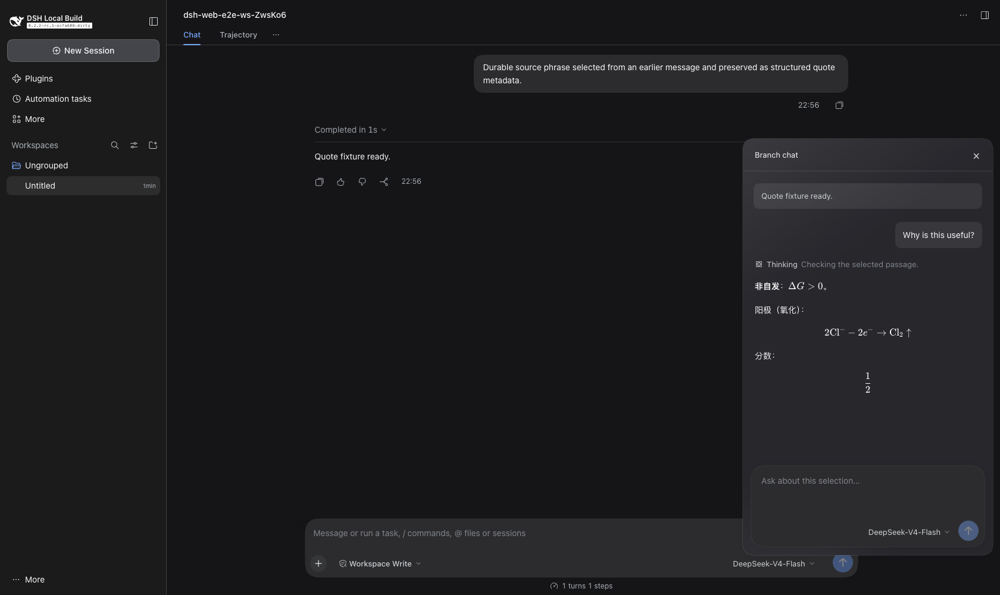

# Inline Branch Chat for DeepSeek Harness

[简体中文](README.zh-CN.md)

Ask a follow-up beside the exact passage you are reading. Select text in a DeepSeek Harness answer, choose **Create branch chat**, and a draggable chat window opens near the selection. The branch inherits the main conversation's completed history at the moment it is created. Its questions and answers stay out of the main transcript.



**Status:** source patch for DeepSeek Harness `dsh-v0.2.2-rc.1` on macOS/Web. This is not yet an independently installable DSH plugin. The patch changes several built-in client packages. It has been applied to a clean source snapshot and the customized local macOS build has been built and exercised. The included GitHub workflow checks a clean upstream build after publication.

## What it does

- Opens a movable, dark branch window beside selected text; multiple windows can coexist.
- Forks a DSH session with the main conversation's completed history. A question such as “solve this using the method you taught me earlier” can use that prior context.
- Keeps branch turns in the child session, outside the main conversation and its left-hand conversation list.
- Reuses the session's model picker, native Markdown/math display, and a one-line preview of real model reasoning. The full reasoning remains expandable.
- Remembers open windows and their positions locally across reloads.

**Context boundary:** the branch is a snapshot, not a live link. New main-chat turns after creation do not automatically enter an existing branch. Branch turns do enter that branch's own history. Closing a window currently removes its local presentation but retains its hidden child session log on disk.

## Install from source

Requires macOS or another system able to build DSH, Node.js 24.9+, pnpm 11.28.5 (or Corepack), and Git. Keep any existing DSH app and profile data separate; this builds a new source checkout.

```sh
git clone https://github.com/deepseek-ai/deepseek-harness.git
cd deepseek-harness
git checkout dsh-v0.2.2-rc.1
git apply --check /path/to/dsh-inline-branch-chat/patches/dsh-v0.2.2-rc.1-branch-chat.patch
git apply /path/to/dsh-inline-branch-chat/patches/dsh-v0.2.2-rc.1-branch-chat.patch
corepack enable
pnpm install --no-frozen-lockfile
pnpm run build
pnpm dsh web
```

Replace `/path/to/dsh-inline-branch-chat` with your clone of this repository. Open the URL printed by `pnpm dsh web`. To package a macOS app, follow the [official Desktop build guide](https://github.com/deepseek-ai/deepseek-harness/blob/dsh-v0.2.2-rc.1/apps/desktop/README.md) after the build. The app may need macOS's usual approval for unsigned local builds.

For a Codex-assisted installation, use the [installation skill](skills/dsh-inline-branch-chat/SKILL.md). It checks the source version, applies the patch in a separate checkout, and verifies the result without touching an existing app or user profile.

## Verify

```sh
git diff --check
pnpm run build
pnpm exec vitest run packages/session/message-quotes/tests/branch-math.client.spec.ts packages/session/message-quotes/tests/quote-selection.client.spec.tsx
```

In the app, select a phrase in an assistant reply, create a branch, ask a question that refers to an earlier main-chat turn, and confirm that the answer appears only in the branch. The screenshot above uses synthetic test text, not a personal conversation.

## Limitations

- Tested against the pinned `dsh-v0.2.2-rc.1` source line only. Other releases may need a new patch.
- This build needs source compilation. There is no one-command plugin installation yet.
- Window removal does not erase the child session log. Do not interpret the × button as secure deletion.
- A branch inherits the latest completed main-chat prefix when it is created, even if the selected passage came from an older turn.
- A branch can use the same workspace and tools as the parent session. Changes made by a tool are real and are not undone when the window closes.

## Credits and license

Built as a modification of [DeepSeek Harness](https://github.com/deepseek-ai/deepseek-harness), which is MIT licensed. The patch contains changes to upstream files. Preserve the [MIT license](LICENSE) and upstream attribution when redistributing modified versions. This project is not affiliated with DeepSeek AI.
