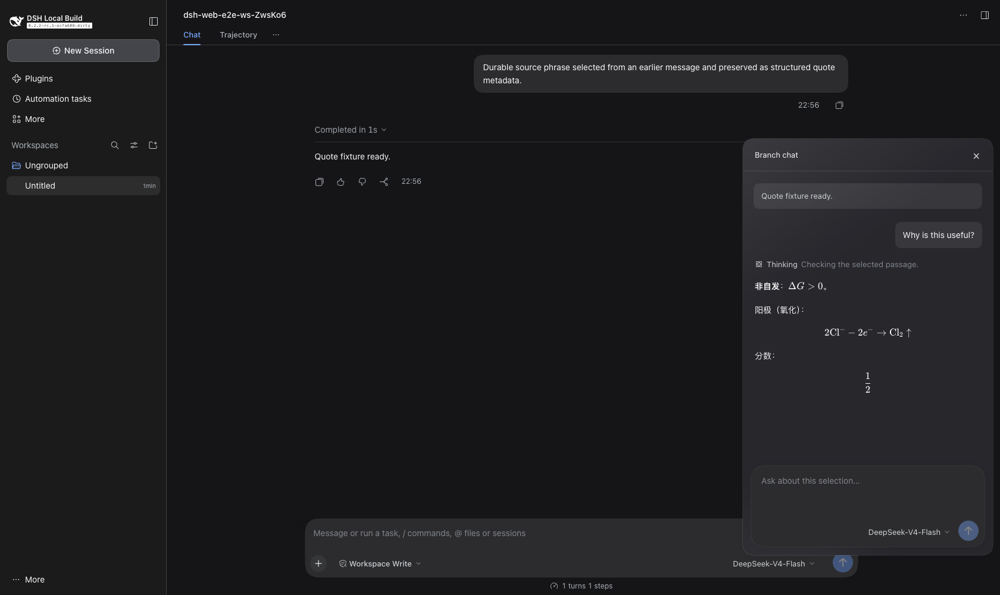

# DeepSeek Harness 原文旁分支聊天

读长回答时，选中一句话，点击**创建分支聊天**，即可在原文旁打开可拖动的小窗追问。分支会继承创建时主聊天中已完成的内容；分支里的问答不会出现在主聊天记录里。



**当前发布形式：**适用于 DeepSeek Harness `dsh-v0.2.2-rc.1` 的源码补丁，需要自己构建。它目前不是可一键安装的独立插件；补丁会修改 Harness 内置的几个界面组件。补丁已在干净的源码快照上验证可应用，本地 Mac 定制版已构建和实际使用；公开仓库的全新构建仍需验证。

## 功能

- 选中回答中的文字后，在附近打开可拖动的深色追问窗；可同时打开多个。
- 分支继承当时主聊天已完成的上下文，例如能理解“按之前教我的方法再做一遍”。
- 分支问答只保存在自己的会话中，不写入主聊天，也不显示在左侧普通聊天列表。
- 可以在分支中选择模型；回答沿用 Harness 的 Markdown、数学公式显示及一行实时思考摘要，完整思考内容可展开。
- 记住仍打开的小窗及位置。

**上下文边界：**创建后主聊天新产生的内容不会自动同步给旧分支；分支内部后续追问会记住该分支自己的问答。点击 × 会关闭小窗，**目前不会从磁盘删除隐藏的分支会话记录**。

## 源码安装

需要 Node.js 24.9+、pnpm 11.28.5（或 Corepack）和 Git。请使用新的源码目录，保留你原有的应用与个人数据。

```sh
git clone https://github.com/deepseek-ai/deepseek-harness.git
cd deepseek-harness
git checkout dsh-v0.2.2-rc.1
git apply --check /你的路径/dsh-inline-branch-chat/patches/dsh-v0.2.2-rc.1-branch-chat.patch
git apply /你的路径/dsh-inline-branch-chat/patches/dsh-v0.2.2-rc.1-branch-chat.patch
corepack enable
pnpm install --no-frozen-lockfile
pnpm run build
pnpm dsh web
```

把 `/你的路径/dsh-inline-branch-chat` 换成这个仓库在你电脑上的真实位置。Mac 桌面应用的打包步骤见 [DSH 官方说明](https://github.com/deepseek-ai/deepseek-harness/blob/dsh-v0.2.2-rc.1/apps/desktop/README.md)。如果想让 Codex 帮你安装，可使用仓库内的 [安装 skill](skills/dsh-inline-branch-chat/SKILL.md)。

## 已知限制

- 仅针对上述 DSH 版本制作；其他版本需要重新适配。
- 需要编译源码，尚不支持一条命令安装。
- 关闭小窗不等于删除磁盘记录。
- 即使选中的是很早以前的回答，分支也会继承创建时主聊天**全部已完成**的内容。
- 分支沿用主会话的工作区与工具；工具造成的文件改动不会因关窗而撤销。

本项目基于 [DeepSeek Harness](https://github.com/deepseek-ai/deepseek-harness) 的 MIT 许可源码修改；再分发时请保留 [MIT 许可与原作者署名](LICENSE)。本项目与 DeepSeek AI 无隶属关系。
